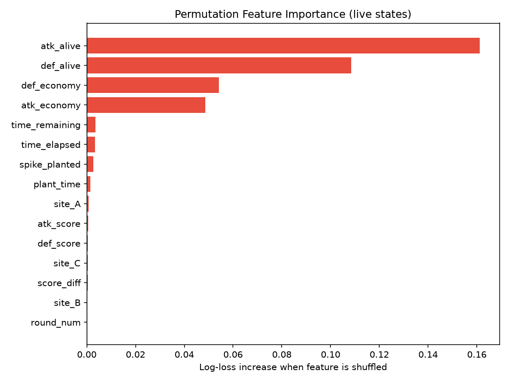
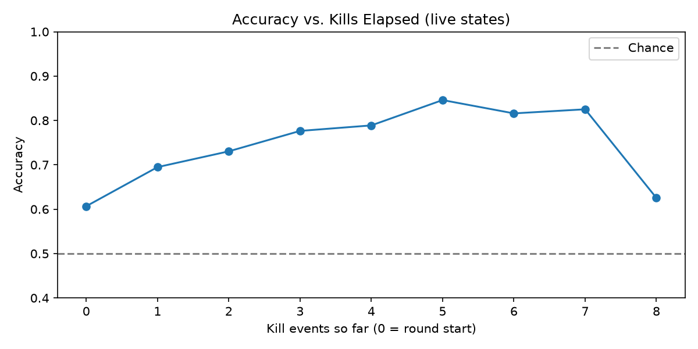

# Valorant In-Round Win Probability Predictor

[](https://github.com/jefferinooo/valorant-predictor/actions/workflows/tests.yml)

**[Live Demo →](https://valorant-predictor-production.up.railway.app)**

A live win probability model for Valorant that updates dynamically after each kill and spike plant — the same concept used in professional esports broadcast overlays. Given the current round state (players alive, spike planted, time remaining, economy), the model outputs the probability that the attacking team wins.

---

## Results

All numbers are on a **held-out test set of 147 matches** (3,151 rounds) that played no part in training or checkpoint selection. Every **live state** is scored: each snapshot where both teams still have a player alive (25,251 states). Final snapshots where one side has been wiped are excluded because they give the answer away.

| Model | Accuracy | Log-loss | Brier |
|---|---|---|---|
| Logistic regression, round-start snapshot only | 60.6% | 0.644 | 0.227 |
| Logistic regression, current snapshot only | 76.3% | 0.468 | 0.155 |
| **2-layer LSTM, full event history** | **77.0%** | **0.463** | **0.153** |

In-round information is worth about 15 points of accuracy over pre-round prediction. The LSTM's history adds a small but statistically significant gain (log-loss 0.468 → 0.463; 95% CI of the difference excludes zero). Most of the signal is in the *current* state: who's alive, economy, and spike status.

### Results by situation
Same test set, split by game situation. Confidence intervals come from a match-level bootstrap (1,000 resamples), because states from the same match are correlated. Δ log-loss below zero means the LSTM beats the snapshot baseline.

| Situation | States | Atk win rate | LR start acc | LR snapshot acc | LSTM acc | LSTM 95% CI | Δ log-loss vs LR snapshot (95% CI) |
|---|---|---|---|---|---|---|---|
| All live states | 25,251 | 50% | 60.6% | 76.3% | 77.0% | 76.1% – 78.0% | -0.006 (-0.009, -0.002) |
| Round start | 3,151 | 48% | 61.9% | 61.3% | 60.8% | 59.3% – 62.5% | -0.004 (-0.006, -0.002) |
| Pre-plant | 18,089 | 42% | 62.3% | 74.5% | 75.0% | 74.0% – 76.1% | -0.003 (-0.006, +0.000) |
| Post-plant | 7,162 | 68% | 56.3% | 81.0% | 81.9% | 80.4% – 83.5% | -0.013 (-0.023, -0.004) |
| Even numbers | 7,844 | 50% | 58.6% | 60.0% | 61.0% | 59.5% – 62.6% | -0.008 (-0.012, -0.004) |
| Attackers up | 8,395 | 84% | 56.1% | 84.5% | 84.7% | 83.2% – 86.1% | -0.005 (-0.011, +0.002) |
| Defenders up | 9,012 | 17% | 66.6% | 83.0% | 83.7% | 82.1% – 85.4% | -0.005 (-0.009, -0.001) |
| 1vX clutch | 4,860 | 50% | 61.4% | 92.4% | 92.5% | 91.6% – 93.5% | -0.012 (-0.023, -0.002) |
| 1v1 | 632 | 51% | 53.0% | 58.2% | 64.1% | 60.6% – 67.7% | -0.028 (-0.059, +0.002) |
| Pre-plant, 0-30s | 13,361 | 44% | 62.9% | 72.9% | 73.3% | 72.2% – 74.6% | -0.001 (-0.004, +0.003) |
| Pre-plant, 30-60s | 4,015 | 39% | 61.2% | 79.6% | 80.1% | 78.3% – 81.9% | -0.008 (-0.014, -0.002) |
| Pre-plant, 60s+ | 713 | 30% | 58.9% | 76.4% | 78.1% | 73.2% – 82.9% | -0.003 (-0.028, +0.022) |

- **Even fights are the hard part.** At equal numbers the model is only 61% accurate. Once one side is up a player, it's around 84%.
- **History helps most after the plant and in 1v1s.** Post-plant is where the LSTM's edge over the snapshot baseline is clearest. In 1v1s it is 6 points more accurate (64.1% vs 58.2%), though with only 632 states the log-loss interval just touches zero.
- **Round start is a coin flip plus economy**, around 61% for every model, since nothing has happened yet.

### Calibration
The model's probabilities track observed win rates closely across the full range. When it says 75%, attackers win about 75% of the time. For a live win-probability overlay that matters more than raw accuracy.

> **Earlier versions of this README reported 99% accuracy.** That number came from evaluation leakage: the model was scored on the round's final state, which usually shows one team fully eliminated, and a one-line "who got wiped?" rule gets 98.5% on those rounds. Other fixes: attack and defense sides were inverted; spike plant time was visible before the plant; kills after a detonation or defuse (including spike-blast kills) created snapshots of already-decided rounds; revives weren't tracked (they are now detected from the player positions logged with each kill); score features tracked sides instead of teams; and results were reported on the same split used to choose the checkpoint. See `src/ingestion/parser.py` and `src/training/train.py`.

<p align="center">
  
  
</p>

<p align="center">
  
  
</p>

### Feature Importance
Permutation importance on live states: **players alive dominates**, followed by **team economy**, which still matters mid-round because it decides what weapons and utility the survivors have. Time, spike status and score add comparatively little once alive counts and economy are known.

---

## Architecture

```
Henrik API → Parser (snapshot per kill + plant) → 15-dim features → 2-layer LSTM (PyTorch)
          → export weights → NumPy inference → FastAPI POST /predict → browser demo
```

Scoring a full round takes about 0.35 ms, and a local `/predict` request about 1–1.5 ms (p50). Full diagram, design decisions and latency numbers: **[docs/ARCHITECTURE.md](docs/ARCHITECTURE.md)**.

---

## Data

Match data was collected from Henrik's Unofficial Valorant API using a **snowball sampling** strategy:

1. Started from a set of seed players (known accounts)
2. Downloaded their 20 most recent competitive matches
3. Extracted all 10 players from each match
4. Fetched those players' match histories in turn

This produced **981 unique competitive matches** across NA servers with no duplicates (deduplication by match ID). Each match was saved as raw JSON and parsed into **RoundSnapshot** sequences — one snapshot at round start, after each kill, and at the spike plant, capturing:

- Players alive on each team
- Whether the spike is planted and on which site
- Time elapsed / time remaining (switches to 45s defuse clock after plant)
- Team economy at round start
- Round number and current score

This yielded **20,696 labeled rounds** (surrendered rounds excluded) (~9 snapshots each) as the training dataset.

---

## Training Details

- **Split**: 70/15/15 train / validation / test, split by **match**: all rounds from a given match go into exactly one set (687 / 147 / 147 matches). Validation picks the checkpoint; test is used only for the reported numbers.
- **Supervision**: the model emits a win probability after every snapshot, and the loss is applied at every timestep. This matches how it is used live, where it only ever sees the round so far.
- **Validation metric**: log-loss on live states only (both teams have a player alive), so the decided final state can't inflate the score.
- **Loss**: Binary Cross-Entropy
- **Optimizer**: Adam, learning rate 1e-3
- **Checkpointing**: best checkpoint saved by live-state validation loss
- **Architecture**: 2-layer LSTM, hidden dim 128, dropout 0.3, sigmoid output head
- **Sequences**: Padded to max length (T=14), PackedSequence used so the LSTM ignores padding

---

## Quick Start

**1. Install dependencies**
```bash
pip install -r requirements-train.txt   # serving alone only needs requirements.txt
```

**2. Set up API keys**
```bash
cp .env.example .env
# Fill in RIOT_API_KEY (developer.riotgames.com)
# Fill in HENRIK_API_KEY (docs.henrikdev.xyz)
```

**3. Collect match data**
```bash
python3 -m src.ingestion.fetch_matches --seeds "PlayerName#TAG"
```

**4. Build features**
```bash
python3 scripts/build_features.py
```

**5. Train the model**
```bash
python3 scripts/train_model.py
```

**6. Evaluate**
```bash
python3 -c "
from src.training.evaluate import evaluate
evaluate('artifacts/models/best.pt', 'data/processed/dataset.npz')
"
```

**7. Serve**
```bash
python3 scripts/serve.py
```

---

## Docker

Train the model first (`scripts/train_model.py`), then run the API in a container:

```bash
docker compose up --build
```

The API will be available at `http://localhost:8000`.

> **Note:** The model checkpoint (`artifacts/models/best.pt`) is not tracked in git due to file size. You must train the model locally before building the Docker image.

---

## API

```bash
curl -X POST http://localhost:8000/predict \
  -H "Content-Type: application/json" \
  -d '{
    "snapshots": [
      {
        "attackers_alive": 5, "defenders_alive": 5,
        "spike_planted": 0, "time_elapsed_ms": 0,
        "time_remaining_ms": 100000, "plant_time_ms": 0,
        "attacker_economy": 15000, "defender_economy": 20000,
        "round_num": 5, "attacker_score": 3, "defender_score": 2,
        "plant_site": ""
      },
      {
        "attackers_alive": 4, "defenders_alive": 4,
        "spike_planted": 1, "time_elapsed_ms": 35000,
        "time_remaining_ms": 45000, "plant_time_ms": 35000,
        "attacker_economy": 15000, "defender_economy": 20000,
        "round_num": 5, "attacker_score": 3, "defender_score": 2,
        "plant_site": "B"
      }
    ]
  }'
```

```json
{
  "win_probability": 0.5506,
  "per_timestep": [0.5595, 0.5506]
}
```

---

## Project Structure

```
├── src/
│   ├── ingestion/
│   │   ├── henrik_client.py     Rate-limited Henrik API client
│   │   ├── fetch_matches.py     Batch match downloader (snowball sampling)
│   │   └── parser.py            Match JSON → RoundSnapshot sequences
│   ├── features/
│   │   └── sequences.py         Feature engineering, normalization, padding
│   └── training/
│       ├── config.py            Hyperparameter dataclass
│       ├── train.py             LSTM model + training loop
│       └── evaluate.py          Calibration, timestep accuracy, feature importance
├── scripts/
│   ├── build_features.py        CLI: build dataset.npz
│   ├── train_model.py           CLI: train LSTM
│   ├── baseline.py              Logistic regression baseline comparison
│   └── serve.py                 FastAPI prediction server
├── tests/                       38 pytest tests (parser, features, situations, API)
└── assets/                      Evaluation plots
```

---

## Tech Stack

Python · PyTorch · FastAPI · scikit-learn · NumPy · httpx · Pydantic
