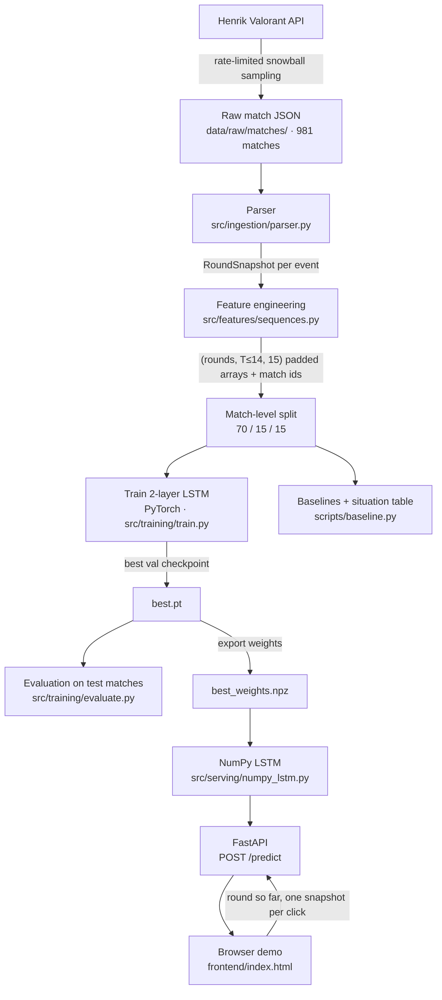

# Architecture

How a raw match becomes a live win probability, and the design decisions behind each stage.

## Stages

**Ingestion** (`src/ingestion/fetch_matches.py`, `henrik_client.py`). Snowball sampling: start from seed players, fetch their recent competitive matches, then fetch the matches of everyone they played with. Requests are rate-limited and matches are de-duplicated by match ID.

**Parsing** (`src/ingestion/parser.py`). Each round becomes a list of snapshots: one at round start, one after each kill, and one at the spike plant. Each snapshot records players alive, spike state, timers, economy, round number and score, plus the round's outcome as the label. The parser handles several data quirks:
- **Sides:** Red attacks rounds 0–11, Blue 12–23, and overtime swaps every round. This was checked against detonations and defuses in the data.
- **Revives** aren't logged directly. They're detected when a player counted dead appears in the positions logged with a later kill.
- **Post-round kills,** including players killed by the spike explosion (which the API labels as "Eliminated"), are cut off at the defuse or at plant + 45s.
- **Plant time** is hidden until the plant happens, so no snapshot leaks a future plant.

**Features** (`src/features/sequences.py`). A 15-dimensional normalized vector per snapshot, padded per round, with a match index kept for splitting.

**Training** (`src/training/train.py`). A 2-layer LSTM (hidden size 128) emits a probability after every snapshot, and the loss is applied at every timestep. This matches how the model is used live, where it only ever sees the round so far.

**Evaluation** (`src/training/evaluate.py`, `src/training/situations.py`, `scripts/baseline.py`):
- **Split:** by match, 70/15/15. Validation picks the checkpoint; test is touched only for reporting.
- **What's scored:** only *live* states (both teams have a player alive). The final state of a round usually shows a wiped-out team, which gives the answer away.
- **Baselines:** logistic regression on the round-start snapshot and on the current snapshot.
- **Situation table:** confidence intervals from a match-level bootstrap, since states within a match are correlated.

**Serving** (`scripts/serve.py`, `src/serving/`). After training, the weights are exported to `.npz`, and the API runs the LSTM forward pass in plain numpy. A test checks it matches PyTorch to within 1e-5. The production image therefore doesn't need PyTorch.

## Key decisions

| Decision | Why |
|---|---|
| Split by match, not round | Rounds from one match share players and context; splitting by round leaks between train and test. |
| Score live states only | The last snapshot usually shows one team eliminated. Scoring it inflated accuracy to 99% in an earlier version. |
| Per-timestep loss | The live model sees partial rounds; training only on full rounds would mismatch serving. |
| Separate test split | Choosing the best epoch on validation makes validation scores optimistic. |
| Cluster bootstrap for CIs | Resampling individual states would make the intervals far too narrow. |
| NumPy serving | The forward pass is a few matrix multiplies; dropping PyTorch shrinks the image and removes a heavy dependency. |

## Performance

Measured with `scripts/benchmark_latency.py` (results in `artifacts/latency.md`). Re-run it with `--url <deployed URL>` to include network time.

Machine: arm64 / Darwin / Python 3.11.6. Times in milliseconds. One request carries the round so far (T snapshots).

### In-process model call (1000 runs each, single thread)

| T | numpy p50 | numpy p95 | numpy p99 | PyTorch p50 | PyTorch p95 | PyTorch p99 |
|---|---|---|---|---|---|---|
| 1 | 0.03 | 0.04 | 0.04 | 0.09 | 0.09 | 0.10 |
| 5 | 0.14 | 0.14 | 0.15 | 0.18 | 0.19 | 0.20 |
| 10 | 0.25 | 0.28 | 0.29 | 0.29 | 0.30 | 0.33 |
| 14 | 0.35 | 0.36 | 0.37 | 0.37 | 0.39 | 0.41 |

### HTTP `POST /predict`, local uvicorn (300 runs each)

| T | p50 | p95 | p99 |
|---|---|---|---|
| 1 | 0.78 | 1.04 | 1.09 |
| 5 | 0.87 | 1.01 | 1.08 |
| 10 | 1.09 | 1.40 | 1.79 |
| 14 | 1.44 | 1.94 | 2.61 |

**What this shows:**
- **The model is not the bottleneck.** A full round (14 snapshots) takes about 0.35 ms to score, and an end-to-end local request is about 1–1.5 ms at the median. From a browser, network latency to the server dominates.
- **NumPy is faster for short sequences** (about 3× at T=1) and roughly equal to PyTorch at full length. The recurrence is sequential either way, and PyTorch's fixed per-call overhead matters most on short inputs.
- **The main win from NumPy serving is size, not speed.** The serving dependencies (FastAPI, uvicorn, pydantic, numpy) take about **52 MB** installed, against about **640 MB** for PyTorch and its dependencies on the same machine. On Linux, a default `pip install torch` also pulls in several GB of CUDA libraries unless the CPU-only wheel is requested explicitly.

